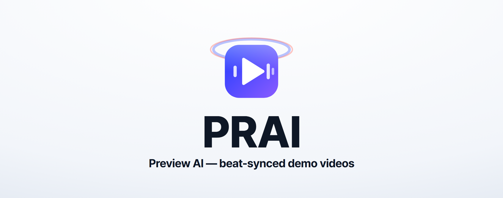
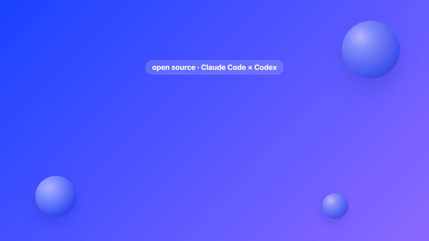
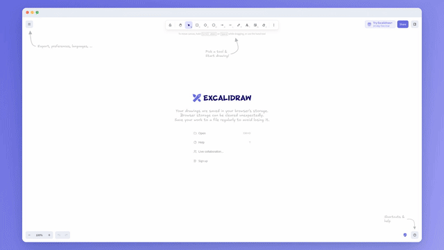

<div align="center">



# PRAI · Preview AI

**JSON 파일 하나로 만드는, 박자에 맞춘 제품 시연·출시 영상**<br>
실제 제품 화면을 찍고, 영상을 박 단위로 적고, 렌더합니다. Claude Code가 감독하고 Codex가 검토하고 Remotion이 그립니다.

[바로 시작](#바로-시작) ·
[예제](#prai로-만든-영상) ·
[작동 원리](#작동-원리) ·
[Claude Code × Codex](#claude-code--codex-역할-분배) ·
[레퍼런스](#레퍼런스-라이브러리) ·
[스펙](docs/spec.md) ·
[English](README.md)



<sub>☝️ PRAI 소개 영상입니다. <a href="projects/prai/prai.json">PRAI 자신의 스펙</a>으로 PRAI가 만들었습니다. 화면은 모두 실제 산출물입니다(스펙, 터미널, 박자표, Remotion Studio, Codex 검토 기록). <a href="docs/media/prai.mp4">소리와 함께 보기(mp4)</a></sub>

</div>

---

## 왜 PRAI인가

화면 녹화는 정직하지만 밋밋합니다. 모션그래픽 스튜디오는 멋지지만 느립니다.
보통은 그 사이 어딘가에서, 누군가 타임라인 위의 키프레임을 하나씩 옮기며 박에 맞는 "느낌"을 찾습니다.

PRAI는 이 편집을 **타임라인 대신 스펙**으로 바꿉니다.

- **목업이 아니라 실제 화면을 씁니다.** `prai capture`가 Playwright로 앱을 조작하며 화면을 2배율로 찍습니다. 이름 붙인 요소의 정확한 위치도 같이 저장합니다. 확대와 강조는 픽셀 추측이 아니라 `"compose.title"` 같은 이름으로 겨눕니다.
- **모든 것이 박 위에 있습니다.** 시간은 프레임이 아니라 박으로 적습니다. PRAI가 곡의 BPM, 첫 박, 마디 위치를 잽니다. 카메라 이동, 강조, 클릭, 장면 전환이 모두 박에 "도착"합니다. 곡을 바꾸면 영상이 알아서 다시 맞춰집니다.
- **인트로·아웃트로 모션그래픽을 박자표로 씁니다.** 단어 컷, 숫자 카운트, 칩, 시간 막대, 유광 구체, 리본, 원형 전환, 로고 등장 같은 블록 17종을 박 번호로 배치합니다. 강세는 곡의 마디를 따릅니다.
- **자막과 목소리가 들어 있습니다.** 장면마다 헤드라인을 넣고, TTS 문장 타이밍에 맞춘 말 자막을 붙입니다. 목소리가 나오면 배경음악이 자동으로 줄어들고, 최종 음량은 −14 LUFS로 맞춥니다.
- **에이전트 둘이 일을 나눕니다.** Claude Code가 쓰고 만듭니다. Codex는 읽기 전용으로 검토합니다. 검토 모델은 고정하고, 작업마다 추론 강도를 정하고, 회차에 상한을 둡니다. 지적마다 판단과 이유를 기록합니다.
- **취향을 설명할 수 있습니다.** 레퍼런스 라이브러리가 "저 영상 느낌"을 이름 있는 기법으로 바꿉니다. 그리고 장면에 도움이 되는 기법만 남깁니다.

## PRAI로 만든 영상

아래 영상 셋은 모두 [`projects/`](projects)에 있습니다. 클론해서 다시 렌더할 수 있습니다.

| | |
|---|---|
| <br>**박자에 맞춰 그리는 Excalidraw** — excalidraw.com에서 직접 찍은 35초짜리 비공식 데모입니다. 캔버스 그리기는 캡처 스크립트로 했습니다. [mp4](docs/media/excalidraw.mp4) · [스펙](projects/excalidraw/prai.json) · [Codex 검토 기록](projects/excalidraw/reviews/ledger.md) | <br>**Shipnote** — 가상의 릴리스 노트 앱입니다. 음악은 PRAI가 직접 만들어서(CC0) 내려받을 필요가 없습니다. 목소리는 온라인 TTS를 씁니다(`--no-voice`면 완전히 오프라인). [mp4](docs/media/quickstart.mp4) · [스펙](projects/quickstart/prai.json) · [앱](projects/quickstart/app/index.html) |

## 바로 시작

필요한 것: Node 18.18 이상, Microsoft Edge 또는 Chrome(화면 캡처용), 목소리를 넣으려면 Python과 `pip install edge-tts`.

```bash
git clone https://github.com/seojaeohcode/PRAI.git
```
```bash
cd PRAI && npm install
```
```bash
npm run prai -- all quickstart
```

이 명령 하나로 음악을 만들고, 목소리를 녹음하고(edge-tts, 온라인), 스펙을 검사하고, 렌더와 마무리까지 합니다. 결과는 `out/quickstart/quickstart.mp4`입니다. 인터넷 없이 하려면 `--no-voice`를 붙입니다.

내 제품으로 만들 때:

```bash
npm run prai -- init myapp
```

1. `projects/myapp/capture.json`에 앱 주소와 찍을 화면을 적고 `npm run prai -- capture myapp`을 실행합니다.
2. `projects/myapp/prai.json`에 장면, 대사, 헤드라인을 적습니다. 편집기가 JSON 스키마로 자동 완성해 줍니다.
3. `npm run prai -- studio myapp`으로 미리 보고, `npm run prai -- all myapp`으로 렌더합니다.

Claude Code를 쓴다면 스킬을 설치하고 영상을 만들어 달라고 말하면 됩니다.

```text
/plugin marketplace add seojaeohcode/PRAI
/plugin install prai@prai
```

## 작동 원리

1. **캡처**: 캡처 계획대로 앱을 조작하며 화면을 찍고, 요소 위치를 `rects.json`에 저장합니다.
2. **측정**: 곡의 BPM, 첫 박, 마디 위치, 마디별 에너지를 잽니다. 대사는 TTS로 녹음하고 길이와 문장 타이밍을 잽니다.
3. **풀이**: 타임라인 계산기가 스펙과 측정값으로 장면, 목소리, 자막, 음악 덕킹을 프레임에 배치합니다. 프레임 반올림은 한 곳에서만 합니다.
4. **렌더**: Remotion이 모션 블록, 시연 카메라, 자막, 오디오를 그립니다. ffmpeg로 음량(−14 LUFS)과 색 범위(bt709)를 맞춥니다.
5. **검사와 검토**: `prai check`가 스펙 문제, 읽기 시간, 음량, 박 정렬률을 잽니다. `prai sheet`로 만든 프레임 묶음을 Codex가 검토합니다.

"쫀득한" 느낌의 규칙은 하나입니다. **움직임은 박에 도착합니다.** 몇 프레임 먼저 출발해 박에 정확히 닿고, 작은 오버슈트로 자리를 잡습니다. 튀는 세기는 박의 강세(마디 첫 박 > 셋째 박 > 둘째·넷째 박)와 장면의 강도를 따릅니다. 자세한 필드는 [docs/spec.md](docs/spec.md)에 있습니다.

## Claude Code × Codex 역할 분배

PRAI는 에이전트 둘이 만들었고, 그렇게 쓰도록 만들었습니다. 역할 분배는 프롬프트 한 줄이 아니라 도구에 들어 있습니다.

| | Claude Code — **감독** | Codex — **검토자** | 사람 |
|---|---|---|---|
| 스펙·캡처·코드 작성 | ✅ | — | 목표와 취향을 줍니다 |
| `prai` 명령 실행 | ✅ | — | — |
| 콘티·박자표·프레임·코드·레퍼런스 검토 | — | ✅ 읽기 전용 | — |
| 지적마다 결정(수용·부분 수용·기각 + 이유) | ✅ | — | 뒤집을 수 있습니다 |
| 최종 승인 | — | — | **소리를 켜고 한 번 봅니다** |

설정은 [`agents.json`](agents.json)에 있고, `prai review`가 그대로 지킵니다.

- **검토 모델은 하나로 고정합니다**(`reviewer.model`). 실행이 실패하면 PRAI가 멈추고 원인을 알립니다. 다른 모델로 몰래 바꾸지 않습니다.
- **작업마다 추론 강도를 정합니다.** 박자표와 마지막 회차는 `xhigh`, 콘티·프레임·코드·레퍼런스는 `high`입니다.
- **회차 상한은 4회입니다.** 미리 계획합니다: 콘티 → 박자표·레퍼런스 → 프레임(+코드) → 최종. 마지막 회차에서는 부작용까지 모두 고치고 끝냅니다.
- **ledger**(`reviews/ledger.md`)에 지적마다 결정과 이유를 남깁니다.

이 규칙들은 실제 작업에서 나왔습니다. 12회까지 간 검토의 마지막 몇 회차가 대부분 수정의 부작용을 고치는 일이었습니다. 약속과 다른 모델이 돌린 검토는 다시 해야 했습니다. 자세한 내용은 [docs/ko/roles.md](docs/ko/roles.md)에 있습니다.

## 레퍼런스 라이브러리

누구에게나 "이런 느낌이면 좋겠다" 싶은 영상이 있습니다. PRAI는 그 영상을 근거로 바꿉니다.

```bash
npm run prai -- refs add myapp https://youtu.be/… --note "박마다 단어가 바뀌는 게 좋음"
npm run prai -- refs research myapp "핀테크 앱 출시 영상"   # Codex 웹 검색 → 확인 전 후보
npm run prai -- refs brief myapp                            # 장면 + 레퍼런스 + 기법 카드 38개 + 평가 기준
npm run prai -- refs check myapp                            # style.json의 근거·장면별 상한·시그니처·기각 목록 검사
```

- **기법 카드 38개**([library/techniques.json](library/techniques.json)): 박 착지, 단어 컷, 매치컷, 스포트라이트, 숫자 카운트, 시간 막대 겹침 같은 기법입니다. 카드마다 언제 쓰는지, 언제 쓰면 안 되는지, 위험, PRAI에서 만드는 방법이 있습니다.
- **평가 기준**([library/rubric.md](library/rubric.md)): 먼저 탈락 조건을 봅니다(사실이 아님, 권리 없음, 만들 수 없음, 아무도 안 본 근거). 그다음 가중 점수를 매기고, 항상 "아무것도 안 했을 때"와 비교합니다. 장면당 주 기법 1개와 보조 1개까지만 씁니다. 시그니처 모티프는 *내 제품*의 소재로 하나 만듭니다. `refs check`는 구조 규칙(시간 표시가 있는 관찰 근거, 장면별 상한, 시그니처, 기각 목록)만 검사합니다. 사실·권리·점수는 감독이 판단하고, 원하면 `review <p> refs`로 Codex에게도 묻습니다.
- **본 사람만 근거가 됩니다.** 영상에서 배운 기법에는 실제로 본 사람의 시간 표시 관찰이 있어야 합니다. 검색 결과는 그때까지 "후보"로 남습니다. 영상은 내려받지 않습니다.

## 명령

| 명령 | 하는 일 |
|---|---|
| `init <이름>` | 템플릿으로 새 프로젝트 |
| `capture <p>` | 화면 캡처 + 요소 위치 측정 |
| `music <p> [--synth]` | `music.url`에서 받기, 또는 CC0 그루브 만들기 |
| `beat <p>` | BPM·첫 박·마디 위치·마디별 에너지 측정 |
| `voice <p>` | 대사 녹음(edge-tts, 로컬 명령, 직접 녹음한 파일) |
| `plan <p>` | 장면표와 박자표 |
| `check <p>` | 스펙 검사, 읽기 시간, 음량, 박 정렬률 |
| `studio <p>` | Remotion Studio로 미리 보기 |
| `render <p>` | 렌더 + 마무리(−14 LUFS, bt709) |
| `sheet` · `still` · `gif` | 프레임 묶음 · 한 프레임 · GIF |
| `review <p> <종류>` | Codex 검토: storyboard · beats · frames · refs · code |
| `refs <하위명령> <p>` | 레퍼런스 라이브러리 |
| `all <p>` | music → beat → voice → check → render (오류가 있으면 멈춤) |

## 한계

- **Windows 11에서 시험했습니다**(Edge, Node 22). macOS·Linux도 될 것으로 보지만 아직 시험하지 않았습니다.
- 검사는 승인이 아닙니다. `prai check`는 음량과 박 정렬을 재고, 프레임 묶음은 배치를 보여 줍니다. 둘 다 영상이 좋다는 증명은 아닙니다. **소리를 켜고 한 번 봐야 합니다.**
- 박 분석과 박자 격자는 템포가 하나로 일정한 곡을 전제로 합니다. 템포가 바뀌는 곡은 아직 지원하지 않습니다. `music.bpm/offset`을 직접 적는 것은 분석기가 일정한 템포를 잘못 잡았을 때만 도움이 됩니다.
- 화면 배치는 16:9 기준입니다(어떤 크기로든 축소됩니다). 세로 영상 배치는 계획에 있습니다.

## 믿을 수 있는 것만 실행하세요

> `voice.command`는 셸 명령을, `capture.script`는 내 권한의 Node.js 코드를, `steps.eval`은 방문한 페이지의 JavaScript를 실행합니다. 캡처의 클릭과 업로드는 실제 서비스에 작용합니다. 믿을 수 있는 작성자의 프로젝트만 실행하세요. edge-tts는 대사를 Microsoft 온라인 서비스로 보냅니다. Codex의 읽기 전용 설정은 검토에만 적용되고, 캡처·TTS·렌더에는 적용되지 않습니다.

- PRAI 코드는 **Apache-2.0**입니다. **Remotion은 별도 라이선스**를 따릅니다. 개인과 직원 3명 이하 회사는 무료이고, 그보다 크면 회사 라이선스가 필요합니다.
- Pretendard 폰트는 SIL OFL 1.1입니다(라이선스 전문 동봉). 원곡 파일은 저장소에 없습니다. 다만 `docs/media`의 예제 MP4에는 Kevin MacLeod 곡 두 개의 일부가 들어 있습니다(CC BY 4.0, 잘라내고 음량을 맞춤). 출처와 링크는 [NOTICE](NOTICE)에 있습니다. PRAI가 만든 그루브는 CC0입니다.
- edge-tts는 비공식 클라이언트입니다. PRAI는 생성된 음성의 권리를 보장하지 않습니다. Excalidraw는 MIT 오픈소스이고, 이 데모는 비공식이며 관계가 없습니다. 자세한 것은 [NOTICE](NOTICE)에 있습니다.

## 시작된 이야기

PRAI는 조선소 해커톤에서 만든 작업허가서 검토 앱 croScan의 64초 홍보 영상에서 시작했습니다. 그 영상은 Claude Code와 Codex가 하룻저녁에 만들었습니다.
그 방식을 일반화하다가 원본 영상의 오차를 찾았습니다. 곡은 136 BPM이 아니라 135 BPM이었고, 그래서 영상 끝에서는 박이 1박쯤 밀렸습니다.
원본을 어떻게 만들었고 PRAI가 무엇을 바꿨는지는 [docs/ko/making-of.md](docs/ko/making-of.md)에 정리했습니다.

<div align="center"><sub>PRAI, Claude Code, Codex로 만들었습니다 · <a href="LICENSE">Apache-2.0</a></sub></div>
