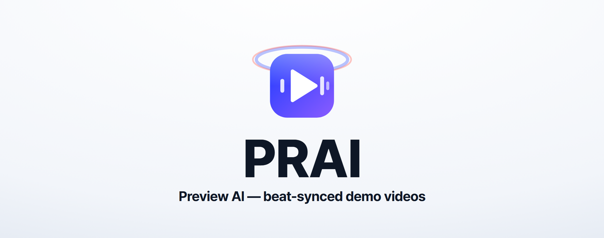
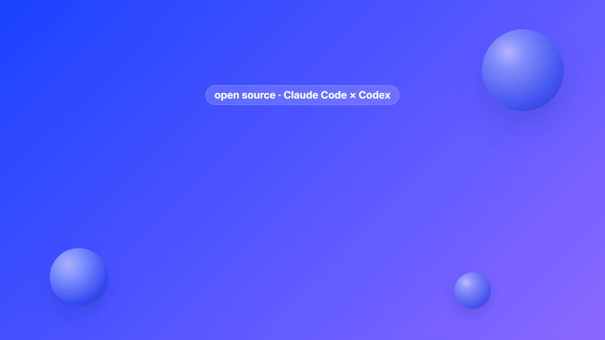
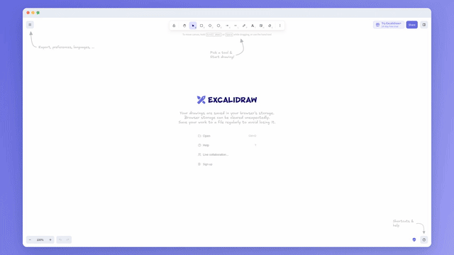
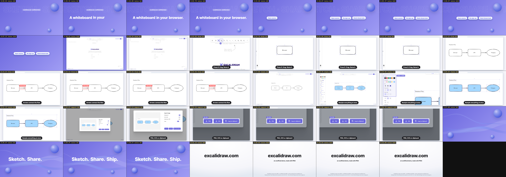
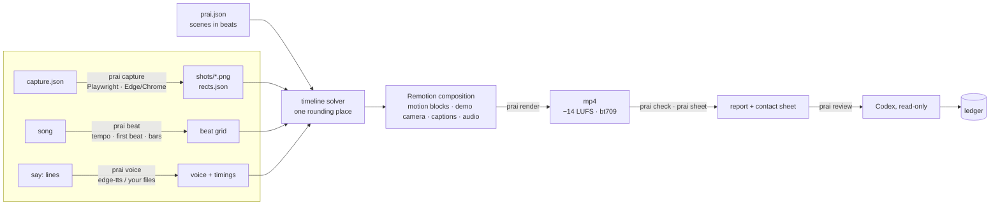

<div align="center">



# PRAI · Preview AI

**Beat-synced product demo & launch videos from one JSON file.**<br>
Capture your real product, describe the video in beats, render. Claude Code directs, Codex reviews, Remotion renders.

[Quick start](#quick-start) ·
[Examples](#made-with-prai) ·
[How it works](#how-it-works) ·
[Claude Code × Codex](#claude-code--codex) ·
[References](#a-reference-library-not-a-copy-machine) ·
[Spec](docs/spec.md) ·
[한국어](README.ko.md)




<sub>☝️ PRAI's launch video — made with PRAI, from <a href="projects/prai/prai.json">its own spec</a>. Every screen is a real artifact: the spec, the terminal, the beat sheet, Remotion Studio, the Codex review ledger. <a href="docs/media/prai.mp4">Watch with sound (mp4)</a>.</sub>

</div>

---

## Why PRAI

Screen recordings are honest but flat. Motion-graphics studios are beautiful but slow. Most launch videos land in between:
someone zooms into screenshots on a timeline, nudging keyframes until things *feel* on the beat.

PRAI makes that edit **a spec instead of a timeline**:

- **Real screens, not mock-ups.** `prai capture` drives your app with Playwright and saves every screen at 2× together with the exact boxes of the elements you name. Zooms and marks target `"compose.title"`, not pixel guesses.
- **Everything is on the beat.** Times are beats, not frames. PRAI measures the song (tempo, first beat, bar phase), and every camera move, mark, click and cut *arrives* on a beat. Change the song and the video re-times itself.
- **Intro and outro motion graphics as a beat sheet.** 17 blocks — word cuts, counters, chips, timeline bars, glossy orbs, ribbons, wipes, logo reveals — placed by beat, with accents that follow the song's bars.
- **Captions and narration included.** Headlines per scene, spoken subtitles timed from the TTS, narration with automatic music ducking, mastered to −14 LUFS.
- **Two agents, clear jobs.** Claude Code writes and builds; Codex reviews read-only, with a pinned model, per-task reasoning effort and a round cap. Every finding gets a written decision.
- **Taste you can explain.** A reference library turns "I like that video" into named techniques, scores them against your scenes, and keeps only the ones that help.

## Made with PRAI

All three videos below are in [`projects/`](projects) — clone and re-render them.

| | |
|---|---|
| <br>**Excalidraw, sketched on the beat** — a 35-second unofficial demo shot on excalidraw.com (canvas drawing via a capture script). 135 BPM, Kevin MacLeod. [mp4](docs/media/excalidraw.mp4) · [spec](projects/excalidraw/prai.json) · [Codex review ledger](projects/excalidraw/reviews/ledger.md) | <br>**Shipnote** — a fictional release-notes app served from a local folder. Music generated by PRAI (CC0): no music download; narration uses online TTS (`--no-voice` for fully offline). [mp4](docs/media/quickstart.mp4) · [spec](projects/quickstart/prai.json) · [app](projects/quickstart/app/index.html) |

<details>
<summary><b>What a review round looks like</b> — the contact sheet Codex sees (one frame after every second beat)</summary>



Round 1 on this project caught a real engine bug (every cell showed frame 0). Round 2 asked for close-ups on the style panel and the export buttons. Both are in [the ledger](projects/excalidraw/reviews/ledger.md) with the decision and how it was checked.
</details>

## Quick start

Requirements: Node ≥ 18.18, Microsoft Edge or Google Chrome (for capture), Python + `pip install edge-tts` (optional, for narration).

```bash
git clone https://github.com/seojaeohcode/PRAI.git
```
```bash
cd PRAI && npm install
```
```bash
npm run prai -- all quickstart
```

That uses the committed screens, generates the music, records the narration (edge-tts, online), checks the spec, renders and masters → `out/quickstart/quickstart.mp4`. Fully offline: `npm run prai -- all quickstart --no-voice`.

Your own product:

```bash
npm run prai -- init myapp
```

1. Edit `projects/myapp/capture.json` — your app's URL and the screens to shoot — then `npm run prai -- capture myapp`.
2. Edit `projects/myapp/prai.json` — scenes, lines, headlines (your editor autocompletes it from the JSON schema).
3. `npm run prai -- studio myapp` to preview, `npm run prai -- all myapp` to render.

Using Claude Code? Install the skill and just ask for a video:

```text
/plugin marketplace add seojaeohcode/PRAI
/plugin install prai@prai
```

## How it works



**A demo scene** is a screenshot seen through a camera:

```jsonc
{
  "id": "add", "type": "demo", "shot": "home",
  "say": "Add what the pull requests don't say, in plain words.",
  "headline": "Add what the PRs don't say",
  "camera": [ { "at": 1, "to": "home.new", "pad": 220 }, { "at": 4, "to": "compose.sheet" } ],
  "clicks": [ { "at": 2, "on": "home.new" } ],          // one cursor, touches down on beat 2
  "swaps":  [ { "at": 3, "shot": "compose" } ],          // the next screen is there on beat 3
  "marks":  [ { "at": 5, "on": "compose.title", "label": "Plain words" } ]
}
```

**A motion scene** is a beat sheet:

```jsonc
{
  "id": "intro", "type": "motion", "bg": "brand", "intensity": "high", "beats": 20,
  "cues": [
    { "block": "orbs",    "at": 0, "until": 12 },
    { "block": "counter", "at": 1, "until": 6, "to": 5, "suffix": " PRs merged" },          // rolls, stops on a beat
    { "block": "title",   "at": 6, "until": 12, "text": "Who|writes|the notes?", "step": 1 }, // one word per beat
    { "block": "wipe",    "at": 12, "to": "light" },                           // covers the frame exactly on beat 12
    { "block": "screen",  "at": 18, "shot": "home" }                           // the product grows in → first demo
  ]
}
```

The rule behind the "snappy" feel: a move **arrives** on its beat — it starts a few frames early, lands on the beat,
then settles with a small overshoot scaled by the beat's accent (bar 1 > beat 3 > 2 and 4) and the scene's intensity.
Full reference: [docs/spec.md](docs/spec.md).

## Claude Code × Codex

PRAI was built by two agents, and is meant to be used that way. The split is wired into the tools, not just a prompt.

| | Claude Code — **director** | Codex — **reviewer** | You |
|---|---|---|---|
| writes the spec, captures, code | ✅ | — | goal & taste |
| runs every `prai` command | ✅ | — | — |
| reviews storyboard · beats · frames · code · reference picks | — | ✅ read-only sandbox | — |
| decides on every finding (accept / partial / reject + why) | ✅ | — | can overrule |
| final approval | — | — | watches once **with sound** |

The settings live in [`agents.json`](agents.json) and `prai review` enforces them:

- **One pinned reviewer model** (`reviewer.model`). If it fails, PRAI stops and says why — it never silently switches models.
- **Reasoning effort per task**: `xhigh` for beat sheets and the final round, `high` for storyboard, frames, code, references.
- **A round cap (4)**, planned up front: storyboard → beats/references → frames (+code) → final. The last round fixes everything it raised, side effects included, then you stop.
- **A ledger** (`reviews/ledger.md`) with a decision and a reason for every finding.

```bash
npm run prai -- review myapp beats        # Codex, read-only, xhigh, beat sheets attached
npm run prai -- review myapp frames       # renders a contact sheet and attaches it
```

These rules came from real work (a 12-round review that was mostly fixing fixes, a review re-done because a different model ran it). The full story: [docs/roles.md](docs/roles.md).

## A reference library, not a copy machine

Everyone has videos they want theirs to feel like. PRAI turns them into evidence:

```bash
npm run prai -- refs add myapp https://youtu.be/… --note "words cut on the beat"
npm run prai -- refs research myapp "fintech app launch video"   # Codex web search → unverified candidates
npm run prai -- refs brief myapp                                  # scenes + references + 38 technique cards + rubric
npm run prai -- refs check myapp                                  # checks style.json: evidence, scene limits, signature, rejects
```

- A **catalog of 38 techniques** ([library/techniques.json](library/techniques.json)) — beat landing, word cuts, match cuts, spotlight, count-up, timeline overlap… each with when to use it, when not to, its risk, and how PRAI builds it.
- A **rubric** ([library/rubric.md](library/rubric.md)): hard fails first (untrue, unlicensed, unbuildable, unwatched evidence), then a weighted score, always compared with doing nothing. ≤ 1 primary + 1 secondary technique per scene, one signature motif made from *your* product. `refs check` enforces the structural part (watched evidence with a time code, per-scene limits, a signature, a rejected list); truth, rights and the score are the director's judgement — and Codex's, with `review <p> refs`.
- **Evidence or it didn't happen**: a technique learned from a video needs a time-coded observation from someone who watched it. Research results stay "candidate" until then. Nothing is downloaded.

The skill [`skills/prai-refs`](skills/prai-refs/SKILL.md) walks Claude Code through it.

## Commands

| command | |
|---|---|
| `init <name>` | new project from `templates/starter` |
| `capture <p>` | shoot screens + measure elements (`capture.json` steps or a `capture.mjs` script) |
| `music <p> [--synth]` | download `music.url`, or generate a CC0 groove |
| `beat <p>` | tempo, first beat, bar phase, energy per bar → `prai.lock.json` |
| `voice <p>` | narrate every `say` line (edge-tts · a local command · your recordings) |
| `plan <p>` | scene table + beat sheets → `out/<p>/plan.md` |
| `check <p>` | spec lint, reading time, loudness, beat alignment → `out/<p>/report.md` |
| `studio <p>` | Remotion Studio with live props |
| `render <p>` | render + master (−14 LUFS, bt709) → `out/<p>/<p>.mp4` |
| `sheet <p>` · `still <p>` · `gif <p>` | contact sheet · one frame · a GIF |
| `review <p> <kind>` | Codex review: storyboard · beats · frames · refs · code |
| `refs <sub> <p>` | reference library: add · list · research · frames · brief · check |
| `all <p>` | music → beat → voice → check → render (stops on errors) |

## What's in the box

```
src/engine     spec schema (zod), beat grid, timeline solver, theme
src/motion     17 motion blocks, cue life cycle (lead → land → settle → leave), groove
src/demo       device frame, beat-locked camera, marks, one continuous cursor, typed cards
src/captions   headline + spoken subtitles     src/audio   music bed, ducking, voices, sfx
cli/           capture · beat analysis · tts · check · review · refs · synth
library/       38 technique cards + the rubric        prompts/   Codex review templates
skills/        Claude Code skills (prai, prai-refs)   agents.json  who does what
projects/      prai · excalidraw · quickstart         templates/starter
```

## Limits, honestly

- **Tested on Windows 11** (Edge, Node 22). macOS/Linux should work (Playwright, Remotion and ffmpeg-static are cross-platform) but are not tested yet.
- Checks are not approval: `prai check` measures loudness and beat alignment, contact sheets show layout. Neither proves the video works. **Watch it once with sound.**
- Beat analysis and the grid assume one steady tempo (most library music). Tracks that change tempo are not supported yet; a manual `music.bpm/offset` only helps when the analyser picks the wrong steady tempo.
- Layout is designed at 16:9 (scaled to any size); vertical video layouts are on the roadmap.
- `custom` techniques in the catalog (mask reveal, magnifier inset, before/after split, shape morphing…) are not built yet.

Roadmap: vertical formats, more blocks from the `custom` cards, an A/B "effect vs. no effect" render for techniques, recipe → spec compiler, cloud TTS providers.

## Trust and licences

> Run projects and capture plans only from authors you trust. `voice.command` runs a shell command, `capture.script` runs Node.js with your permissions, `steps.eval` runs JavaScript in the page you visit, and capture clicks/uploads act on the real service. edge-tts sends your lines to Microsoft's online service. Codex's read-only sandbox covers reviews only — not capture, TTS or rendering.

- PRAI's code: **Apache-2.0**. **Remotion has its own licence** — free for individuals and companies with up to 3 employees, a company licence above that ([details](https://www.remotion.pro/license)).
- Pretendard font: SIL OFL 1.1 (bundled with its licence). Music: the source tracks are not in the repository, but the example MP4s in `docs/media` contain excerpts of two Kevin MacLeod tracks (CC BY 4.0, trimmed and loudness-normalised) — credits and links in [NOTICE](NOTICE). Generated grooves: CC0.
- edge-tts is an unofficial client; PRAI does not grant any right to the generated voice. Excalidraw is MIT open source; the demo is unofficial and not affiliated. See [NOTICE](NOTICE).

## The story

PRAI started as a 64-second promo for croScan, a work-permit review app built at a shipbuilding hackathon, made in one evening by Claude Code and Codex.
Generalising it found a bug in the original: the song was 135 BPM, not 136, so that video drifted by about a beat by the end.
How the original was made and what PRAI changed: [docs/ko/making-of.md](docs/ko/making-of.md) (Korean).

<div align="center"><sub>Made with PRAI, Claude Code and Codex · <a href="LICENSE">Apache-2.0</a></sub></div>
