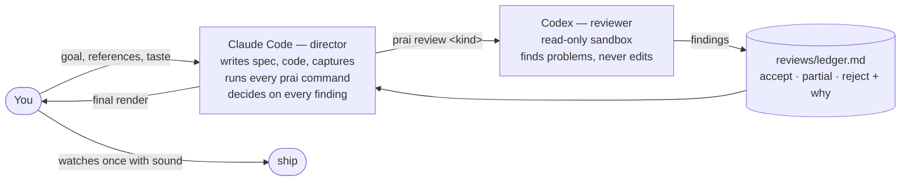

# Roles: Claude Code directs, Codex reviews, you decide what is good

PRAI was built — and is meant to be used — by two agents with different jobs. The split below is not a suggestion
in a prompt; it is wired into the tools: `agents.json` holds the settings, `prai review` enforces the sandbox, the model,
the reasoning effort per task and the round cap, and the ledger records every decision.



## Who does what

| | Claude Code (director) | Codex (reviewer) | You |
|---|---|---|---|
| Storyboard, `prai.json`, capture plans | writes | reviews (`storyboard`) | gives the goal |
| Beat sheets for intro/outro | writes | reviews (`beats`, effort **xhigh**) | — |
| Rendering, checks, contact sheets | runs | reviews the stills (`frames`) | — |
| New code (blocks, CLI) | writes | reviews (`code`) | — |
| References | collects, watches, writes observations | researches candidates (`refs research`), scores picks (`refs`) | brings the ones you love |
| Decisions on findings | **decides** and writes why | — | can overrule |
| Final approval | — | — | **watches with sound**, publishes |

## Rules that came from real work

These rules were written while making the croScan promo and PRAI itself, each after something went wrong.

1. **Codex only reviews.** It runs with `-s read-only`. It never edits files and never makes the final call.
   Anything that can be built — synthetic data, assets, blocks — the director builds itself. *(Splitting the making
   between two agents made the work slower and harder to follow.)*
2. **One model, fixed.** The reviewer model is set in `agents.json` (`reviewer.model`). If it fails (quota, plan,
   login), PRAI stops and says why. It never switches to another model on its own, and a round that ran on another model is
   redone. *(A review from a different model than agreed was not trusted, so the work had to be repeated.)*
3. **Reasoning effort per task.** `xhigh` for design decisions, beat sheets, QA verdicts and the final round; `high` for
   routine checks (storyboard, frames, code, references). The last allowed round uses `final` (xhigh) automatically. Change it per task in `agents.json → reviewer.effort`, or once with `--effort`.
4. **Rounds are capped (default 4).** Plan them up front: ① storyboard (or design) ② beats / references ③ render: frames (code too when the
   engine changed) ④ final regression. The last round fixes everything it raised — side effects included — and then you stop. What is
   left becomes a known limit in the ledger. When findings turn into side effects of your own previous fixes, end early.
   *(One validation once ran to 12 rounds; rounds 10–12 were mostly fixing the fixes.)*
5. **Every finding gets a decision.** `accept`, `partial` or `reject`, with the reason and how it was checked, in
   `reviews/ledger.md`. Rejected findings are not raised again without new evidence. Reviews are input, not orders.
6. **Long runs happen once.** Freeze the code; give Codex the checking code and a sample of the logs in one `xhigh`
   review; run once; afterwards fix only real defects and re-run only the affected cases.
7. **Nothing exaggerated.** Numbers on screen must be true and labelled with their source ("demo data"). Overlaps are
   "needs review", not "danger". The director words claims down when in doubt.
8. **Checks are not approval.** `prai check` measures loudness, beat alignment and spec problems; stills show layout.
   Neither proves the video works. A person watches it once with sound before it ships.
9. **Don't ask the person what you can decide.** The director does not stop to ask "A or B?" or "shall I continue?". It
   decides, does the work, and reports what it chose and why. It asks only for things only the person can give
   (taste, approval to publish, accounts).
10. **Work in parallel and clean up after yourself.** While Codex reviews or a render runs, the director does the next
    independent task. It stops only the processes it started (by PID), never by name.

## Settings: `agents.json`

```jsonc
{
  "reviewer": {
    "agent": "Codex", "sandbox": "read-only",
    "model": "gpt-6-astra",                // pinned; PRAI_CODEX_MODEL overrides for one run
    "on_model_failure": "stop and report the cause",
    "effort": { "storyboard": "high", "beats": "xhigh", "frames": "high", "refs": "high",
                "research": "high", "code": "high", "final": "xhigh" }   // "final" = the last allowed round
  },
  "rounds": { "max": 4, "last_round": "fix everything it found, side effects included, then stop" }
}
```

`prai review <project> <kind>` reads this file, builds the prompt from `prompts/<kind>.md` (with the plan, the spec,
the ledger and, for `frames`, a contact sheet attached as an image), runs
`codex exec -m <model> -c model_reasoning_effort=<effort> -s read-only …`, saves the answer as `reviews/NN-<kind>.md`
and opens a round in the ledger. Without the Codex CLI it writes the prompt so you can paste it anywhere.

Set `PRAI_CODEX` to the Codex executable if it is not on your PATH.

## In practice

```bash
npm run prai -- review myapp storyboard     # round 1
npm run prai -- review myapp beats          # round 2 (xhigh)
npm run prai -- render myapp && npm run prai -- review myapp frames   # round 3
npm run prai -- review myapp code --focus "src/motion/blocks.tsx"    # optional, counts as a round
```

After each round the director edits `reviews/ledger.md`:

```markdown
## Round 3 — frames (2026-11-01)
| # | finding | decision | why / how checked |
|---|---|---|---|
| 1 | label covers the heading at 0:12 | accept | moved label below; checked on the new sheet |
| 2 | intro feels empty at b14–16 | reject | it is the breath before the logo; beats review agreed |
```
